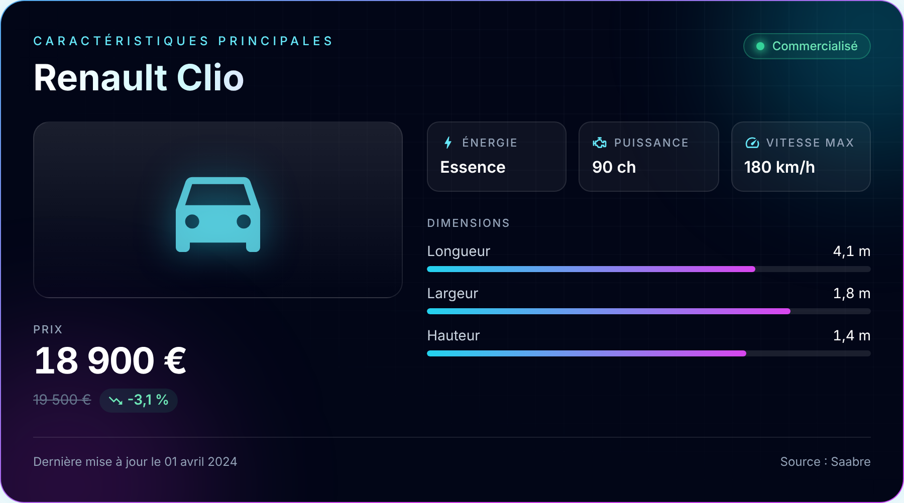
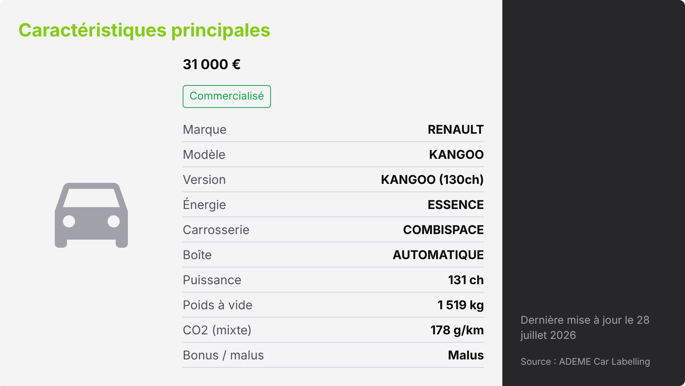
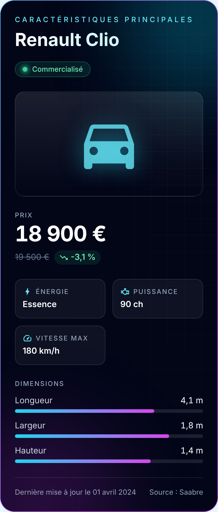

<div align="center">

# Résumé de véhicule

**Bloc Gutenberg qui affiche la fiche technique d'un véhicule à partir d'une source de données externe.**

[](https://github.com/Aziguy/resume-de-vehicule/actions/workflows/ci.yml)
[](https://codecov.io/gh/Aziguy/resume-de-vehicule)
[](LICENSE)
[](CHANGELOG.md)

[](https://wordpress.org/)
[](https://www.php.net/)
[](https://react.dev/)
[](https://tailwindcss.com/)
[](https://jestjs.io/)
[](https://phpunit.de/)



</div>

## Objectif

Permettre aux rédactions d'insérer en quelques clics une fiche technique claire et à jour dans un article WordPress : prix (et son évolution), statut de commercialisation, motorisation, dimensions, émissions, etc. Le journaliste recherche un véhicule, le bloc fait le reste.

## Fonctionnalités

- Bloc **Résumé de véhicule** dans une catégorie dédiée « Brakson Gutenberg blocks ».
- Recherche avec autocomplétion (marque, modèle) directement dans le bloc ou dans la barre latérale.
- Carte responsive : n'affiche que les informations disponibles, tendance du prix, badge de commercialisation, source citée.
- Bouton **Actualiser les données** dans la barre d'outils du bloc.
- **Sources de données interchangeables** depuis *Réglages > Résumé de véhicule* :
  - `saabre` : API historique du projet ;
  - `ademe` : open data public [ADEME Car Labelling](https://data.ademe.fr/datasets/ademe-car-labelling) (Licence Ouverte 2.0), sans clé d'API.
- Proxy REST côté serveur (`/wp-json/resume-vehicule/v1/vehicles`) avec cache configurable : pas d'appel tiers depuis le navigateur, pas de souci CORS, moins de requêtes.
- Migration automatique des blocs enregistrés avec la version 1.0.
- Styles Tailwind isolés dans le bloc : aucun impact sur le thème ni sur l'éditeur.

## Captures

| Source ADEME (open data) | Mobile |
| --- | --- |
|  |  |

## Prérequis

- WordPress 6.6 ou plus
- PHP 7.4 ou plus

## Installation

1. Télécharger l'archive `resume-vehicule-block.zip` depuis la page [Releases](https://github.com/Aziguy/resume-de-vehicule/releases) (ou cloner le dépôt dans `wp-content/plugins/`, le dossier `build/` étant versionné).
2. *Extensions > Ajouter > Téléverser une extension*, puis activer.
3. Choisir la source de données dans *Réglages > Résumé de véhicule*.

## Utilisation

1. Ajouter le bloc **Résumé de véhicule** dans un article.
2. Saisir une marque ou un modèle puis sélectionner le véhicule.
3. Publier. Le bouton d'actualisation permet de récupérer les dernières données à tout moment.

## Sources de données

| Source | Accès | Données | Limites |
| --- | --- | --- | --- |
| Saabre (`saabre`) | URL configurable | prix catalogue et actuel, statut, énergie, vitesse max, dimensions, date de mise à jour | API de démonstration hébergée sur Scalingo, disponibilité non garantie |
| ADEME Car Labelling (`ademe`) | public, sans clé | marque, modèle, version, énergie, carrosserie, boîte, puissance, poids, CO2, bonus/malus, prix | véhicules neufs vendus en France uniquement, ni dimensions ni vitesse max |

Si l'API Saabre ne répond plus, il suffit de basculer sur `ademe` dans les réglages. D'autres pistes publiques existent : [NHTSA vPIC](https://vpic.nhtsa.dot.gov/api/) (marques et modèles, gratuit) ou [cars-data.com](https://cars-data.com/en/api/for-ai-agents) (fiches complètes, clé gratuite limitée).

### Ajouter une source

Implémenter `ResumeVehicule\Providers\ProviderInterface` et l'enregistrer via un filtre :

```php
add_filter( 'resume_vehicule_providers', function ( array $providers ) {
	$providers[] = new My_Provider();
	return $providers;
} );
```

Chaque fournisseur renvoie des véhicules normalisés avec `ResumeVehicule\Vehicle::normalize()`.

### Hooks

| Hook | Type | Rôle |
| --- | --- | --- |
| `resume_vehicule_providers` | filtre | ajouter ou remplacer des sources |
| `resume_vehicule_settings` | filtre | forcer des réglages (ex. via le code d'un thème) |

## Architecture

```
resume-vehicule-block.php    Amorçage du plugin
includes/
├── Plugin.php               Enregistrement du bloc, catégorie, hooks
├── Settings.php             Page de réglages et options
├── RestController.php       Proxy REST /resume-vehicule/v1/vehicles
├── VehicleRepository.php    Cache (transients) devant la source active
├── Vehicle.php              Format normalisé d'un véhicule
└── Providers/               Saabre, ADEME, client HTTP, registre
src/
├── block.json               Métadonnées du bloc
├── edit.js / save.js        Éditeur et rendu enregistré
├── components/              VehicleCard, VehicleSearch
├── hooks/                   useVehicleSearch
├── api/                     Client REST (apiFetch)
├── utils/                   Formatage et normalisation
└── deprecated/              Migration des blocs 1.0
tests/
├── js/                      Jest + Testing Library
└── php/                     PHPUnit + Brain Monkey
```

## Développement

```bash
git clone https://github.com/Aziguy/resume-de-vehicule.git
cd resume-de-vehicule
npm install
composer install
```

| Commande | Rôle |
| --- | --- |
| `npm start` | compilation en mode watch |
| `npm run build` | compilation de production dans `build/` |
| `npm run lint` | ESLint et Stylelint (standards WordPress) |
| `npm test` | tests JavaScript |
| `npm run test:coverage` | tests JavaScript avec couverture |
| `composer test` | tests PHP |
| `npm run plugin-zip` | archive installable |

Un environnement WordPress local peut être lancé avec [`@wordpress/env`](https://developer.wordpress.org/block-editor/reference-guides/packages/packages-env/) (`npx wp-env start`).

## Feuille de route

- Rendu dynamique côté serveur pour des prix toujours à jour sur les articles publiés.
- Choix des champs affichés et des couleurs depuis la barre latérale.
- Tests end-to-end avec Playwright et `@wordpress/env`.
- Traductions (`.pot`) et publication sur WordPress.org.

## Contribuer

Les contributions sont les bienvenues : voir [CONTRIBUTING.md](CONTRIBUTING.md).

## Licence

Distribué sous licence [GPL-2.0-or-later](LICENSE).

Données ADEME Car Labelling : [Licence Ouverte 2.0](https://www.etalab.gouv.fr/licence-ouverte-open-licence/), source citée sur chaque fiche.

## Auteurs

- [Hippolyte KENGNI](https://aziguy.github.io/Portfolio-Website/) (Aziguy)
- F7b5
